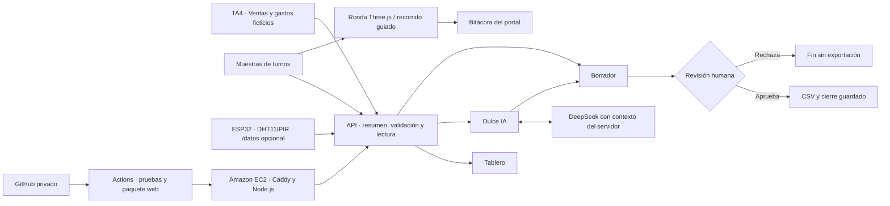

# Mi Dulce Tesoro · Semana 18

Prototipo integrador de Herramientas de Desarrollo Profesional TIC. El portal de la cafetería reúne un tablero de marzo de 2026, Dulce IA, monitoreo ambiental, cierre mensual y una ronda de capacitación. Los datos administrativos del TA4 son ficticios. Los cierres aprobados y las últimas 20 rondas se guardan por navegador y origen.

**[Abrir demostración en AWS](https://mi-dulce-tesoro.52-201-125-89.sslip.io)**

## Ejecutar

Desde esta carpeta con Node.js 22:

```sh
cp -n .env.example .env
npm start
```

Abrir http://localhost:4188. La API de salud está en `/health`. Se puede seleccionar otro puerto con `PORT=4190 npm start`.

### Dulce IA

En el archivo local `.env`, completar `DEEPSEEK_API_KEY=` y reiniciar el servidor. La clave se usa en el servidor y `.env` está excluido de Git. El modelo predeterminado es `deepseek-flash`. El contexto incluye los agregados de marzo y la lectura seleccionada. La respuesta indica su origen. Cuando la clave está vacía o el proveedor falla, el chat responde mediante reglas del prototipo y conserva disponibles el tablero y la aprobación. [API oficial de DeepSeek](https://api-docs.deepseek.com/api/create-chat-completion/)

En EC2, systemd lee `/etc/mi-dulce-tesoro/.env`, con permisos de lectura exclusivos de root. Reinicia el servicio después de actualizar el archivo. El servicio web intenta hasta 300 consultas diarias a DeepSeek por proceso y usa las reglas del prototipo al superar ese límite.

### Sensor y sala

- El tablero inicia con las muestras didácticas de Apertura y Tarde. Para leer el ESP32 real, añadir `ESP32_URL` con el origen HTTP del ESP32 en el `.env` del servidor que pueda alcanzarlo. La opción «ESP32 en vivo» consulta `/datos` y muestra su origen y hora de consulta. Los límites de 28 °C y 65 % HR son didácticos y requieren validación operativa.
- El servidor Node permite abrir una sala temporal con `/ronda/?sala=1`. El estado compartido se guarda en memoria. En el despliegue web están disponibles la ronda 3D individual y el recorrido guiado. La ronda 3D usa teclado y mouse, con WebGL cuando está disponible.

## Despliegue en Amazon EC2

La aplicación se ejecuta en una instancia Amazon Linux 2023 x86_64. Caddy atiende HTTPS y reenvía las solicitudes a Node.js 22, que escucha en localhost. Ambos procesos arrancan con systemd. La instancia usa una dirección IP elástica para mantener el enlace cuando se detiene y se inicia de nuevo. Los archivos JSON contienen los ejemplos de la demostración y el navegador conserva cierres y bitácoras.

Para reproducirlo, asigna una IP pública y un nombre DNS al servidor. Abre los puertos 80 y 443 para la web, y restringe SSH a la IP de administración. Copia el paquete de GitHub Actions a la instancia, descomprímelo y ejecuta desde esa carpeta:

```sh
sudo bash deploy/ec2/instalar.sh NOMBRE_DNS
sudoedit /etc/mi-dulce-tesoro/.env
sudo systemctl restart mi-dulce-tesoro
sudo systemctl status mi-dulce-tesoro caddy
```

Caddy emite y renueva el certificado. Comprueba `https://NOMBRE_DNS/health` y confirma que una consulta en Dulce IA indica «DeepSeek» como origen. Para revisar el servicio usa `sudo journalctl -u mi-dulce-tesoro -u caddy -n 50`.

## Demostración

1. Confirmar S/ 113.00 de ventas, S/ 35.00 de gastos, S/ 78.00 de saldo y 4 tickets. Seleccionar **Tarde** y esperar **Solicitar inspección**.
2. Pulsar «Estado del almacén» en Dulce IA. La respuesta usa 29,4 °C, 71 % HR y el origen de la muestra.
3. Generar el borrador de marzo, revisar cifras y aprobar con una observación. Descargar el CSV y comprobar el bloqueo de otro cierre para el mismo mes. Para ensayar rechazo o entradas inválidas, usarlos antes de la aprobación o abrir un contexto privado del navegador.
4. En la ronda, elegir turno, probar el calentador y el humidificador, recoger la muestra, confirmar tres cajas y firmar. La decisión y los intentos aparecen en la bitácora del portal.

## Arquitectura y vínculo con la rúbrica



| Criterio final | Evidencia |
| --- | --- |
| Diagnóstico (10 %) | PDF 2–3. Cierre repetitivo, trazabilidad de versiones y decisión de almacén. |
| Arquitectura (15 %) | PDF 4 y diagrama. Una API vincula fuentes, tablero, asistente y reporte. |
| Integración (20 %) | PDF 5–9. DevOps, IA generativa, ingeniería de prompts, IoT, automatización de cierre y XR. El flujo web adapta las validaciones del OpenRPA de TA4. |
| Prototipo (20 %) | PDF 10, pasos de demostración y pruebas de aceptación del código. |
| Innovación (10 %) | El contexto ambiental se comparte con Dulce IA y la decisión se practica en 3D. El análisis de cierre y la aprobación quedan ligados al período. |
| Impacto (5 %) | PDF 11. Línea base académica y metas por medir en piloto. |
| Sustentación (10 %) | PDF 5–10: tecnologías, justificación, límites, demostración de tres minutos. |
| Informe final (10 %) | Entregable independiente de la presentación y el prototipo. |

## Verificación y entrega técnica

```sh
npm ci
npm test
```

Las pruebas verifican aritmética en céntimos, validación de cierre, aprobación y duplicados, límites ambientales, adaptación al ESP32, chat por reglas, contrato de DeepSeek con un proveedor simulado y sincronización de sala. GitHub Actions ejecuta estas pruebas y empaqueta los archivos del portal y el instalador de EC2. `/health` comprueba la disponibilidad del servidor. La demostración funcional comprueba el recorrido completo.

Fuentes académicas: TA1 (DevOps), TA2 (Dulce IA), documentación del ESP32 y flujo IoT, TA4 (OpenRPA, datos de prueba y proceso de cierre), Avance 5 (entorno y recorrido Three.js), y evaluación integradora de semana 18.
